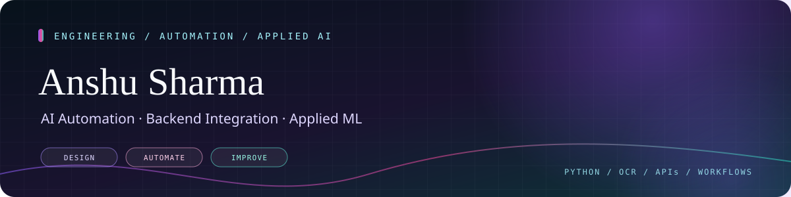

<!--
  ANSHU SHARMA · Profile README
  Custom visual assets are stored in ./assets/readme/.
-->

<p align="center">
  
</p>

<p align="center">
  <a href="https://github.com/AnshuSharma95-as?tab=repositories"></a>
  <a href="https://sharmanshu5.github.io/Portfolio/"></a>
  <a href="https://www.linkedin.com/in/anshu-sharma-b74a07221"></a>
  <a href="mailto:anshusharma5.as@gmail.com"></a>
</p>

<p align="center">
  
</p>

---

<p align="center"></p>

I’m an **AI Automation Engineer** interested in practical systems at the intersection of workflow automation, backend integration, document intelligence, and applied machine learning.

My focus is turning repetitive processes into structured workflows: connecting systems, validating data, handling duplicates and exceptions, and producing useful, maintainable results. I work with Python-based services, browser automation, OCR pipelines, databases, and workflow orchestrators.

```python
engineering_focus = {
    "automation": ["n8n", "Selenium", "webhooks", "workflow design"],
    "backend": ["Python", "FastAPI", "REST APIs", "SQL"],
    "document_ai": ["OCR", "PDF/image preprocessing", "field normalization"],
    "applied_ml": ["feature engineering", "forecasting", "model evaluation"],
    "principle": "Validate data. Handle failure. Protect sensitive information."
}
```

<p align="center"></p>

<table>
  <tr>
    <td width="50%" valign="top">
      <h3>⚙️ Workflow & RPA Automation</h3>
      Browser automation, webhook-driven flows, repetitive operational process reduction, and clear exception handling.
    </td>
    <td width="50%" valign="top">
      <h3>🔎 OCR & Document Intelligence</h3>
      PDF/image preprocessing, field extraction, normalization, structured outputs, and handling low-quality or incomplete documents.
    </td>
  </tr>
  <tr>
    <td width="50%" valign="top">
      <h3>🔌 APIs & Data Integration</h3>
      Python APIs, REST integrations, SQL persistence, and service-to-service workflow orchestration.
    </td>
    <td width="50%" valign="top">
      <h3>🧠 Applied Machine Learning</h3>
      Data preparation, feature engineering, regression/forecasting experiments, model evaluation, and API/dashboard integration.
    </td>
  </tr>
</table>

<p align="center"></p>

### 🔁 AI Automation Assignment — n8n + Python + SQLite
A workflow-integration project combining n8n, a Python API, webhooks, and SQLite-backed processing. It explores payload validation, duplicate-aware processing, and coordinating automation steps.

[View repository on the personal GitHub account](https://github.com/SharmAnshu5/-AI_Automation_Assignment)

### 🧾 OCR Release Order Scanner
A document-processing workflow intended to extract structured fields from Release Order PDFs and images, normalize the results, and create consistent tabular output. Key engineering concerns include preprocessing, validation, folder watching, and error routing.

### ⚡ Retainer RO Ad-Booking Automation
A browser and database automation workflow using Selenium and Oracle DB to reduce repetitive booking steps, update records, and deal with common workflow exceptions.

### 📈 Energy Consumption Forecasting
An applied ML pipeline exploring data preparation, engineered features, regression models such as Random Forest and XGBoost, and API-based serving.

### 🩺 InsuScan Pro — Medical Report Analysis Prototype
A learning project using Streamlit, FastAPI, document parsing, and ML experiments to explore structured medical-report information and understandable summaries.

### 📊 Stock Market Screening & Analysis
A quantitative project exploring market-data ingestion, technical indicators, liquidity filters, time-series features, crossover analysis, and historical backtesting.

> Some work is private, internal, or still evolving. These descriptions avoid proprietary implementation details and do not represent exploratory ML components as production-ready. Public links are included only where an accessible repository is available.

<p align="center"></p>

**Languages & data**

<p>
  
  
  
  
</p>

**Automation & APIs**

<p>
  
  
  
  
  
</p>

**ML, OCR & applications**

<p>
  
  
  
  
  
</p>

**Databases & developer tools**

<p>
  
  
  
  
  
</p>

<p align="center"></p>

<p align="center">
  
  
</p>

<p align="center"></p>

<p align="center"></p>

<p align="center">
  <a href="https://github.com/settings/apps"></a>
  <a href="https://github.com/settings/billing"></a>
</p>

**About official profile badges**

- **Developer Program Member:** Apply through the [GitHub Developer Program](https://docs.github.com/en/integrations/concepts/github-developer-program). Membership is intended for developers building an integration using the GitHub API and providing a support contact.
- **PRO:** Check the account’s plan and upgrade through [GitHub Billing](https://github.com/settings/billing).

GitHub adds these native badges to the profile after the relevant membership or subscription is active. The buttons above are navigation links only; they do not claim either status or imitate an official account badge. [GitHub’s profile badge documentation](https://docs.github.com/en/account-and-profile/reference/profile-reference)

<p align="center"></p>

<p align="center">
  <a href="https://github.com/AnshuSharma95-as?tab=repositories"></a>
  <a href="https://sharmanshu5.github.io/Portfolio/"></a>
  <a href="https://www.linkedin.com/in/anshu-sharma-b74a07221"></a>
  <a href="mailto:anshusharma5.as@gmail.com"></a>
</p>

<p align="center"></p>
